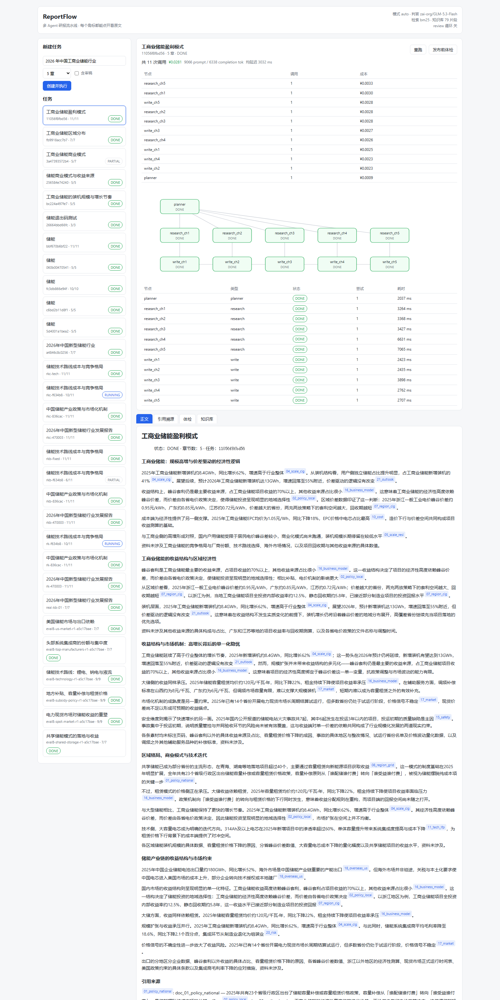
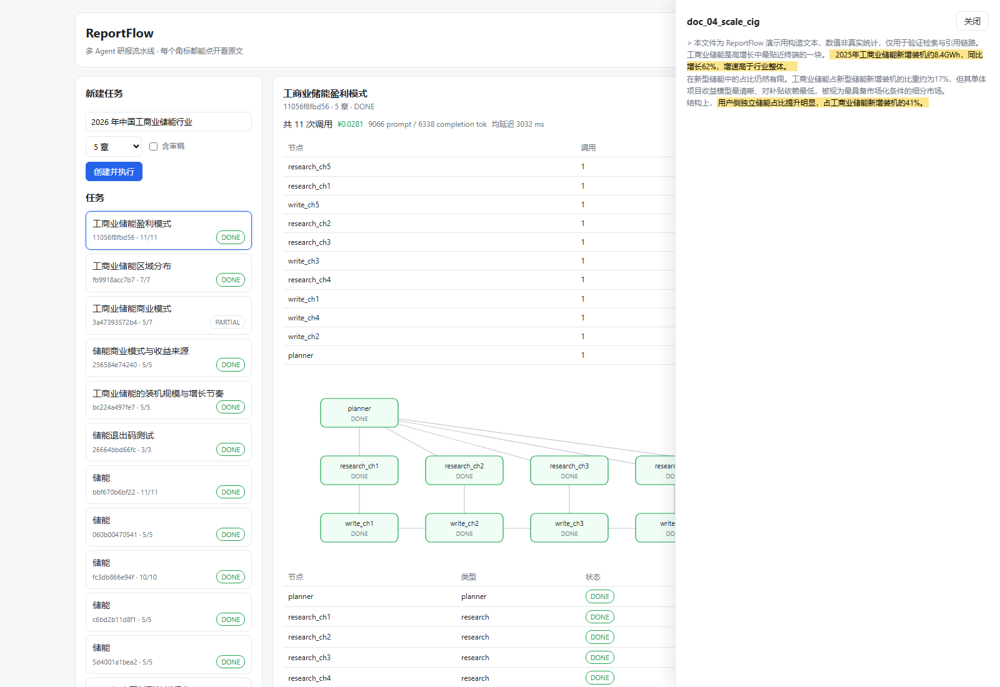
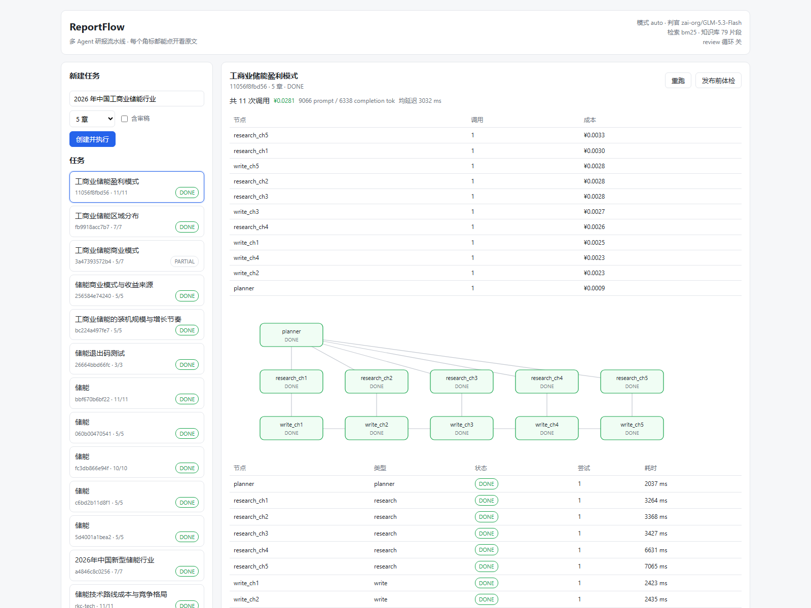
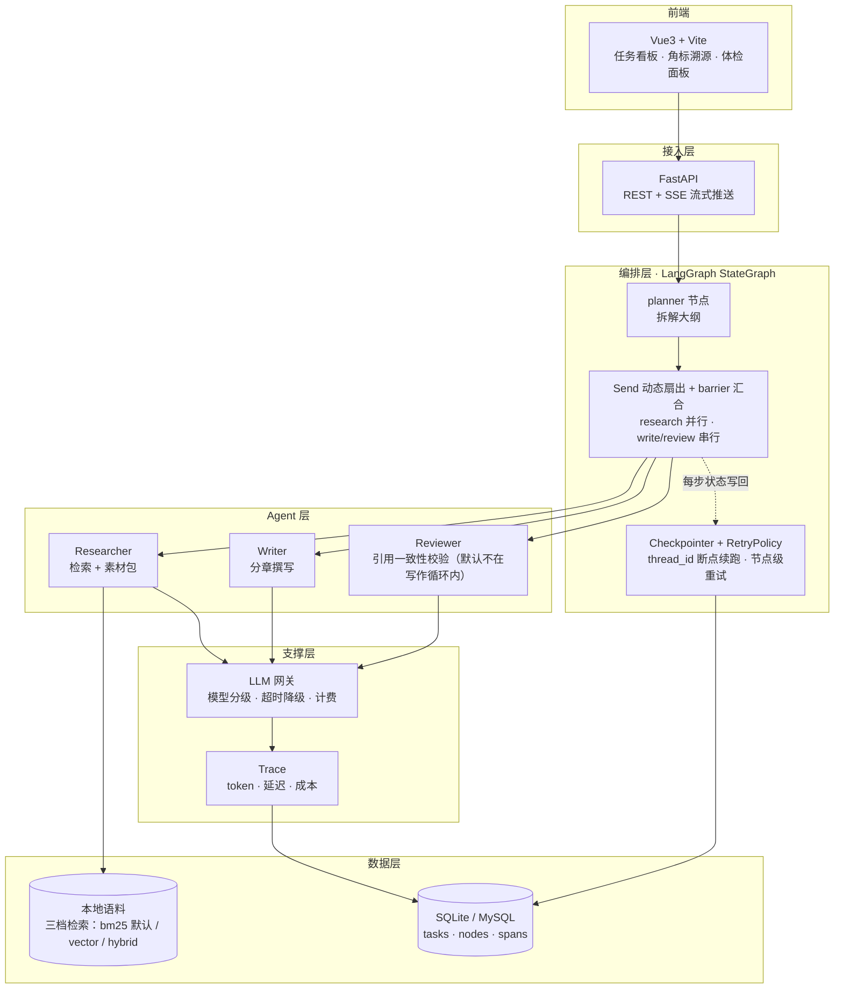
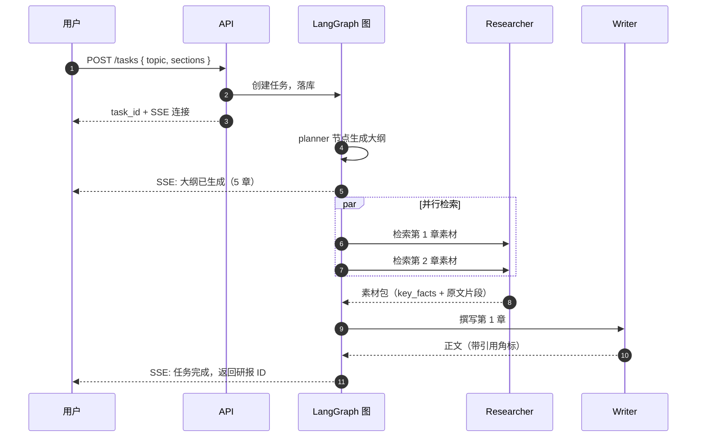

# ReportFlow

> 输入一个行业主题，自动生成一份**每个数据都能追溯到原文**的研报初稿。

[](https://github.com/TheQing1/reportflow/actions/workflows/ci.yml)


做案头研究的痛点是重复劳动：翻 20 篇报告 → 摘到 Word → 标引用 → 拼成文，通常要 1–3 天。

用通用大模型直接写，又有两个致命问题：**数据是编的，引用是假的**。

ReportFlow 解决的是这两件事——让生成过程**分阶段可控**，让每一句结论**都能回溯到知识库里的具体文档**。

它产出的不是成品，是一份**能直接改的初稿**：省掉查资料和搭框架的时间，把精力留给判断和观点。

### 和搜索类 AI 有什么不一样

搜索型 AI 解决的是「回答一个问题」，输出一段短文本加一组链接。ReportFlow 解决的是「产出一份有结构的长文档」：

| | 搜索类 AI | ReportFlow |
|---|---|---|
| 输出 | 一段回答 | 分章节长文 |
| 引用 | 链接列表 | 每个断言绑定到具体文档 |
| 质量 | 一次性生成 | 写完要核对，不合格退回改 |
| 成本 | 不可见 | 能说清钱花在哪个环节 |

一句话：**它是流水线，不是问答。**

---

## 输出长什么样

```markdown
# 2026 年中国工商业储能行业概览

## 1. 市场规模与增长

2025 年工商业储能新增装机约 8.4GWh，同比增长 62%[^doc_05_market_cig]，
其中浙江、广东、江苏三省合计占比 55% 以上[^doc_07_region_cig]……
```

每个 `[^doc_xx]` 都能点开看到对应文档的原文。发布前还能做一次体检，指出哪条断言在它所引的原文里找不到，并提示数据实际出自哪篇。

---

## 界面一览

**执行视图**：DAG 进度、按节点归因的成本表、每个节点的状态与耗时：



**引用溯源抽屉**：点正文里任意一个角标，右侧打开原文，命中片段高亮——你可以逐条核对「这句话真的出自那里」：



**素材清单**：这一章到底用了哪些文档、哪些原文片段、丢弃了多少条不可核验的素材：



> 支持深度链接：`?doc=<doc_id>` 直接打开某篇原文，`?tab=trace|check|corpus` 直达对应面板。把某条引用的原文链接发给同事核对时，对方打开就是高亮后的那一篇。

---

## 核心特性

**多 Agent 流水线，而非一次性生成**
Planner 拆大纲 → Researcher 并行检索 → Writer 分章撰写 → Reviewer 交叉校验。每个环节职责单一，可独立替换、独立评测。

**引用必须能溯源，否则丢弃**
Researcher 产出的每条素材，其 `quote` 必须能在原文中逐字找到，找不到就丢弃；Writer 的角标映射不到素材就直接剥掉；页码由程序按素材重建，不采信模型输出。

**程序校验优先于模型判断**
Reviewer 先用程序核对「断言里的数字是否出现在所引原文」，命中即判定，不调模型；只有语义层面的问题才交给 LLM。又快又准又免费的事，不该花钱让模型猜。

**图编排，支持并行与断点续跑**
整条流水线是一张 LangGraph `StateGraph`：`Send` 按章节数在运行时动态扇出并行、barrier 边做真汇合、条件回边构成写-审-改闭环、Checkpointer 按 `thread_id` 落盘。进程重启后从断点继续，已完成的节点不重跑；节点级失败按 `RetryPolicy` 重试，确定性失败（如回放缓存缺失）不重试。

**全链路成本可归因**
每次调用的 token / 延迟 / 成本落入 spans 表，能回答「这份研报的钱花在哪个环节」，并按节点归因。

**效果有数据，不是感觉良好**
内置 40 个主题的标注评测集，横向对比「单 Agent 直出 / 多 Agent / 多 Agent + Reviewer」三档，配对比较 + 95% 置信区间。结论见[效果与代价](#效果与代价)。

---

## 快速开始

**方式 A · Docker（不需要本地装 Python / Node）**

```bash
cp .env.example .env      # 填 LLM_API_KEY
docker compose up --build # 后端 8000 + 前端 5173
```

**方式 B · 本地**

```bash
# 1) 装依赖
cd backend  && pip install -r requirements.txt
cd ../frontend && npm install

# 2) 配 key（也可不填，见下）
cp .env.example .env      # 填 LLM_API_KEY

# 3) 一键启动：后端 8000 + 前端 5173
./scripts/start.sh          # Git Bash / WSL
scripts\start.bat           # Windows cmd / PowerShell
make dev                    # 同上（Linux / macOS）
```

打开 http://localhost:5173 提交任务、看 DAG 进度、点角标看原文。

常用命令见 `make help`：测试 / lint / 切语料 / 起容器都在里面。

**没有 key 也能跑开发**：默认 `LLM_MODE=auto`，第一次真调后写入 `data/llm_cache/`，之后命中缓存——毫秒级、结果逐字一致、成本 ¥0。要验收真实生成效果时传 `--live`。

命令行同样可用（不启前端）：

```bash
cd backend
python -m app.cli doctor                                   # 自检：key 可用？知识库空不空？
python -m app.cli run --profile real \
    --topic "2026年中国新型储能行业" --sections 5            # 建任务并跑
python -m app.cli export --task-id <id> --check            # 导出 + 发布前体检
python -m app.cli cost   --task-id <id>                    # 钱花在哪个节点
python -m app.cli corpus ls                                # 知识库有哪些文档
```

### 知识库

| 语料 | 篇数 | 性质 | 用途 |
|---|---|---|---|
| `sample-corpus/` | 12 | 虚构数据，口径一致 | 功能验证 |
| `real-corpus/` | 29 | 真实公开数据，可溯源 | 体验真实效果 |
| `data/docs/`（运行时） | — | 上面某一份的副本 | 实际被检索的那个 |

```bash
python -m app.cli corpus init --real        # 装真实语料（替换，不是叠加）
python -m scripts.seed_corpus --clean       # 切回合成语料（评测基线）
```

也可以直接把自己的 `.md` / `.txt` 放进 `data/docs/`，或在界面「知识库」页拖拽上传（同名文件不覆盖，另存为 `_2`）。

> 切换语料是**替换**而非叠加——两套语料文件名不同，叠加会让虚构与真实数据混进同一个库，那样生成的报告真假难辨。

---

## 架构



### 一次任务的时序



### 分层与依赖方向

```
contracts  ←  core  ←  {persistence, agents, rag, llm, evaluation}  ←  orchestrator  ←  {assembler, cli, api}
```

`contracts/` 是叶子层：定义跨层契约，零内部依赖。所有实现只依赖它，彼此不互相依赖。

这条约束由 `tests/test_layering.py` 用 AST 强制校验——任何一层越界引用，测试直接失败。靠自觉守不住的约束，交给机器。

### 代码在哪

| 目录 | 内容 |
|---|---|
| `backend/app/contracts/` | 跨层契约（叶子层，零内部依赖） |
| `backend/app/orchestrator/` | LangGraph 图：State、节点、条件边、Checkpointer |
| `backend/app/agents/` | 四个 Agent + MockAgent（可切换做回归） |
| `backend/app/llm/` | 网关：分级 / 降级 / 计量，以及录制回放 |
| `backend/app/rag/` | 本地语料检索与读写 |
| `backend/app/evaluation/` | 评测：数据集、judge、语义审计、统计 |
| `backend/app/api/` | REST + SSE |
| `backend/scripts/` | 造语料、抓真实语料、造评测集、离线假 LLM |
| `frontend/src/` | Vue3 界面 |
| `eval/` | 40 个标注主题 + 评测入口（`run_eval.py`） |
| `sample-corpus/` `real-corpus/` | 自带的两套语料 |

---

## 技术选型

| 层 | 选型 | 为什么 |
|---|---|---|
| 编排 | **LangGraph `StateGraph`** | 原生就有本项目真正需要的三件事：循环（写-审-改回边）、运行时才知道分支数的并行（`Send`）、断点续跑（Checkpointer）。生态与团队可维护性也明显好于自研。**迁移前是自研 DAG 引擎**（建图 + 调度约 470 行），换框架的动机与代价写在 [STAGE5_ACCEPTANCE.md](docs/STAGE5_ACCEPTANCE.md)，旧实现见 git 历史 |
| 后端 | FastAPI | 原生 async，SSE 实现简单，与 asyncio 调度天然契合 |
| 存储 | SQLite（开发）/ MySQL（生产） | 状态唯一事实来源是数据库；SQLite 让本地零运维跑通，切 MySQL 只改 `DATABASE_URL` |
| 检索 | **三档：bm25（默认）/ vector / hybrid** | 目标是「引用可溯源」而非召回率。默认仍是 BM25：零依赖、结果可复现，也不会因 embedding 升级导致评测基线漂移；向量档是补召回，不是替换。`hybrid` 用 RRF 按**名次**融合两路，不做归一化加权 |
| 前端 | Vue3 + Vite | **没有用图布局库**：图形状固定（planner → 并行 research → 串行 write），三行自己算就够 |
| 可观测 | **自建 Trace** | 只需要 token / 延迟 / 成本三个维度，上 OTel 属于过度设计 |
| 部署 | `scripts/start.sh` / `start.bat` | 一条命令起后端 + 前端。当前是单进程 + SQLite 的本地服务，容器化收益不抵复杂度 |
| 开发期成本 | **LLM 录制/回放** | 改前端/改图结构时会反复跑同一批 prompt。录一次之后全命中缓存：毫秒级、结果确定、¥0 |

刻意不引入：OpenAI SDK（只用 OpenAI 兼容的 HTTP 接口）、向量数据库（22 篇 / 79 片段，纯 Python 点积够用，且自己写才能把「每条向量对应哪段原文」显式存下来）、分词库。
少一个依赖，就少一处版本漂移导致的评测不可复现。

例外只有编排层：`langgraph` 是显式引入的框架依赖。它只用到 `langchain-core` 的基础抽象，
不引入 LangChain 的链，也不替换 `app/llm/` 的网关——检索与 LLM 调用仍然是我们自己的代码。

---

## HTTP 接口

| 接口 | 用途 |
|---|---|
| `POST /api/tasks` | 建任务（`{topic, sections, task_id?, review?}`） |
| `POST /api/tasks/{id}/run` | 后台执行（幂等，已完成的节点不重跑） |
| `GET  /api/tasks/{id}/stream` | SSE：`task` / `node` / `done` 三类事件 |
| `GET  /api/tasks/{id}/export` | 拼好的 markdown |
| `GET  /api/tasks/{id}/trace` | 每章真实用到的素材（溯源面板的数据） |
| `GET  /api/tasks/{id}/check` | 发布前体检结果 |
| `GET  /api/tasks/{id}/cost` | 成本归因（总计 + 按节点 + 回放命中数） |
| `GET  /api/corpus` | 知识库有哪些文档 |
| `POST /api/corpus/upload` | 上传 .md/.txt，立即重新索引 |
| `DELETE /api/corpus/{doc_id}` | 删除一篇 |
| `GET  /api/corpus/{doc_id}` | 一篇文档的全文 |

SSE 用**轮询数据库**而不是给编排层加回调：图完全不知道 HTTP 的存在，崩溃重启后前端连上就能继续看到进度，不需要任何「事件重放」。代价是 300ms 粒度。

---

## 效果与代价

40 个标注主题，三档方案对比（配对比较，同主题内比较以抵消主题难度差异）：

| 方案 | 要点覆盖率 | 引用归属错误 | 单份成本 |
|---|---|---|---|
| A · 单 Agent 直出 | 72.6% | **16 条** | ¥0.006 |
| B · 多 Agent 协作 | **80.2%** | **1 条** | ¥0.020 |
| C · 多 Agent + Reviewer | 80.5% | 2 条 | ¥0.030 |

- **多 Agent 确实更好**：覆盖率 +7.7pp [95% CI +1.6, +13.7]，语义支持率 +7.4pp，均显著
- **收益的实质是「引用归属正确」**：单 Agent 那 16 条错误全是「用了 A 文档的数据、角标挂在 B 文档」——数据是真的，出处是错的。分章检索让角标只能落在本章真实用到的来源上
- **Reviewer 无可测量收益**：B → C 覆盖率 +0.3pp、语义支持率 −0.8pp，均不显著，成本却再涨 49%。已移出默认流水线，改为导出时一次性体检（`--check`）
- **代价**：成本 3.7 倍；论述重复率从 1.1%（单 Agent）升到 8.7%（多 Agent）

判官与生成模型分离（生成用 DeepSeek，判官用 GLM），避免「自己给自己判卷」。

> 上表与下面几条结论都是**改造前的编排基线**（自研 DAG 引擎，`eval/results/v6/`）。
> 编排层迁到 LangGraph 后这轮评测尚未重跑，数字仍然成立但对应的是旧编排，
> 新基线要另起目录重跑——见 [STAGE5_ACCEPTANCE.md](docs/STAGE5_ACCEPTANCE.md) 的未完成项。

> 评测方法、judge 校准、以及「为什么覆盖率一度显示不显著」的完整复盘见
> [docs/STAGE3_ACCEPTANCE.md](docs/STAGE3_ACCEPTANCE.md)。

---

## 已知边界

- 产出定位是**初稿**，还达不到可直接发布的水平
- 只支持中文；知识库需预先灌入，不具备实时联网检索
- **LangGraph 改造后 40 主题评测基线尚未重跑**。上面「效果与代价」的三档数字来自改造前的自研编排（`eval/results/v6/`），对当前代码只能作参考，不能当成本轮改造的评测结论
- 检索的 `vector` / `hybrid` 两档没有专属界面：切档靠 `.env` 的 `RETRIEVAL_MODE`，界面顶部只显示**实际生效**的档位（含降级标记与 embedding 模型），不显示「这条片段由哪一路召回」
- **章节重复率约 8%**（跨章重复的论述片段占比）。根因不是算法：它由「每主题可用文档数」驱动——真实语料实验中该值从 8 提到 11 篇，重复率相应从 13.3% 降到 7.7%。解决它要靠补语料密度；两次专门优化（prompt 层去重、检索层文档预算）都无效甚至有害，已默认关闭。详见 [docs/REPEAT_RATE.md](docs/REPEAT_RATE.md)
- 评测判官跑在 `reasoning_effort=low`（为速度让步），绝对分数可能偏乐观
- 单实例假设：多副本部署需自行按 `task_id` 加分布式锁

---

## 文档

| 文档 | 看什么 |
|---|---|
| [ARCHITECTURE.md](docs/ARCHITECTURE.md) | 设计决策与取舍：为什么这么做，放弃了什么 |
| [STRUCTURE_REVIEW.md](docs/STRUCTURE_REVIEW.md) | 结构审查：目录、分层、依赖方向的问题与修正 |
| [STAGE1_ACCEPTANCE.md](docs/STAGE1_ACCEPTANCE.md) | 自研编排引擎验收（历史记录）：并行/串行、阻塞传播、断点续跑 |
| [STAGE2_ACCEPTANCE.md](docs/STAGE2_ACCEPTANCE.md) | 四个 Agent 与网关验收 |
| [STAGE3_ACCEPTANCE.md](docs/STAGE3_ACCEPTANCE.md) | 评测方法论、三档对比、失败复盘 |
| [STAGE4_ACCEPTANCE.md](docs/STAGE4_ACCEPTANCE.md) | 接口与前端验收 |
| [STAGE5_ACCEPTANCE.md](docs/STAGE5_ACCEPTANCE.md) | 编排迁到 LangGraph + 三档检索：迁移映射、踩坑与修正、实测数据、未完成项 |
| [REPEAT_RATE.md](docs/REPEAT_RATE.md) | 章节重复率：两次失败与真实语料上的因果验证 |
| [CONTRIBUTING.md](CONTRIBUTING.md) | 开发环境、分层约束、测试与 commit 规范 |
| [CHANGELOG.md](CHANGELOG.md) | 版本演进，以及每次改动背后的理由 |

---

## License

MIT — 见 [LICENSE](LICENSE)。

`real-corpus/` 下的语料正文版权归原作者所有（国家能源局、CNESA、人民日报、经济日报、证券时报、央广网等公开来源），MIT 仅覆盖本仓库的代码与文档。
