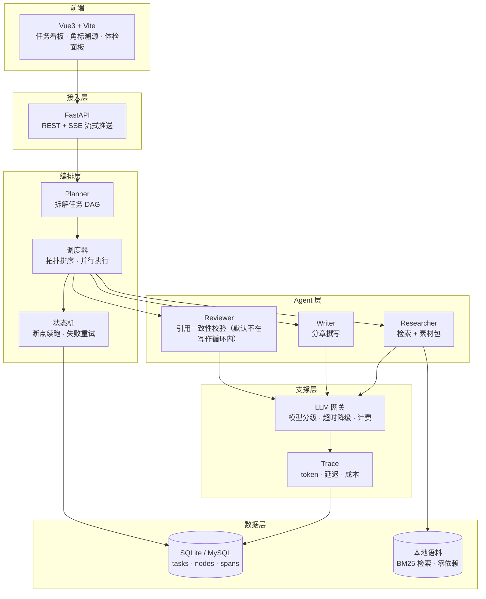
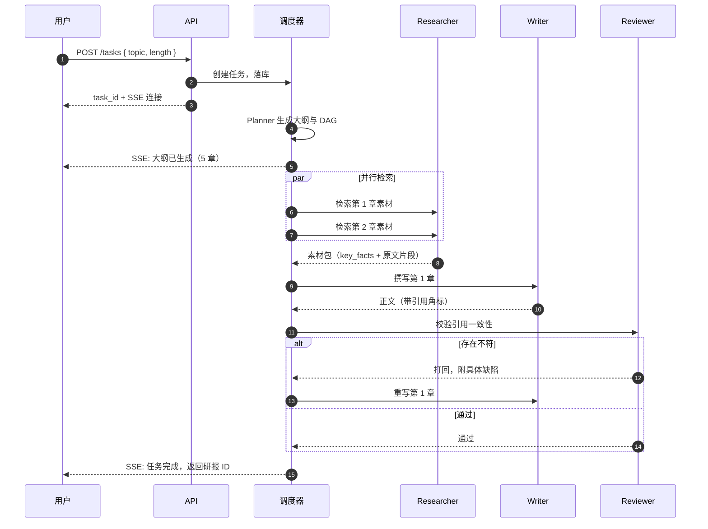

# ReportFlow

> 输入一个行业主题，自动生成一份**每个数据都能追溯到原文某页**的研报初稿。


---

## 为什么做这个

做案头研究的痛点是重复劳动：翻 20 篇报告 → 摘到 Word → 标引用 → 拼成文，通常要 1–3 天。

用通用大模型直接写，又会有两个致命问题：**数据是编的，引用是假的**。

ReportFlow 想解决的是这两件事：让生成过程**分阶段可控**，让每一句结论**都能回溯到知识库里的具体文档和页码**。

它产出的不是成品，是一份**能直接改的初稿**——省掉查资料和搭框架的时间，把精力留给判断和观点。

### 和搜索类 AI 有什么不一样

搜索型 AI 产品解决的是「回答一个问题」，输出是一段短文本加一组参考链接。

ReportFlow 解决的是「产出一份有结构的长文档」：

- 输出是分章节的长文，不是一段回答
- 每个断言绑定到具体文档和页码，而不是给一个链接列表
- 有质量闭环：写完要被核对，不合格退回去改
- 成本可归因：能说清钱花在哪个环节

一句话：**它是流水线，不是问答。**

---

## 它长什么样

```
# 2026 年中国工商业储能行业概览

## 1. 市场规模与增长
2025 年国内工商业储能新增装机约 8.4 GWh，同比增长 62%[1]。
从区域分布看，浙江、广东、江苏三省合计占比超过 55%[2]。

## 2. 竞争格局
市场集中度较低，CR5 约 38%[3]，中小集成商仍在通过低价策略抢占份额。
（本章经 1 次校验后重写）

## 引用来源
[1] 《中国储能产业发展白皮书 2025》P.23
[2] 《2025 年新型储能发展报告》第 2 章
[3] 某上市公司 2025 年年报 P.47
```

角标可点击，展开显示命中的原文片段。

> 📷 截图占位：任务看板 / DAG 执行可视化 / 研报预览页

---

## 核心特性

**多 Agent 流水线，而非一次性生成**
  
Planner 拆大纲 → Researcher 并行检索 → Writer 分章撰写 → Reviewer 交叉校验。每个环节职责单一，可独立替换和评测。

**质量闭环：Reviewer 会打回重写**
  
写完不等于完成。Reviewer 逐条核对「正文断言 vs 引用原文」，不符则携带具体缺陷打回指定章节重做，而不是整篇重来。

**上下文不随轮次膨胀**
  
Agent 之间不传完整对话历史，改用「结论摘要 + 关键片段（原文不摘要）」的结构化交接协议。降低的是**重复传递上游对话历史**这部分开销——单章单轮几乎没有收益，收益随章节数与打回轮次放大，所以定位是**防膨胀**而不是省 token。（实测数字待补）

**DAG 编排，支持并行与断点续跑**
  
自研轻量编排引擎：拓扑排序调度、无依赖节点并行执行、任务状态持久化，进程重启后从断点继续而非整条重跑。

**全链路成本可归因**
  
每个 Agent 的 token、耗时、成本落入 spans 表，能回答「这份研报的钱花在哪个环节」，并据此做模型分级与结果缓存。

**可量化，不是感觉良好**
  
内置 20 个主题的标注评测集，横向对比「单 Agent 直出 / 多 Agent / 多 Agent + Reviewer」三档方案。

---

## 架构



### 一次任务的完整时序



---

## 技术选型

| 层   | 选型                                  | 为什么                                                                                        |
| --- | ----------------------------------- | ------------------------------------------------------------------------------------------ |
| 编排  | **自研 DAG 引擎**                       | 需要精细控制重试粒度与断点续跑持久化，框架黑盒反而增加调试成本。核心逻辑约 300 行                                                |
| 后端  | FastAPI                             | 原生 async，SSE 实现简单，与 asyncio 调度天然契合                                                         |
| 存储  | SQLite（开发）/ MySQL（生产）               | 状态唯一事实来源是数据库；SQLite 让阶段一零运维跑通，切 MySQL 只改 `DATABASE_URL`。Redis 仅作为阶段四的跨进程缓存，不参与正确性          |
| 向量  | BM25 关键词检索（阶段二）/ ChromaDB + BGE（可选） | 现阶段目标是"引用可溯源"而不是召回率；关键词检索零依赖、结果可复现，也不会因 embedding 模型升级导致评测基线漂移。同义改写的召回缺口等阶段三评测数据再决定是否值得上向量 |
| 前端  | Vue3 + Vite                         | **没有用 Vue Flow**：DAG 形状固定（planner → 并行 research → 串行 write），三行自己算就行，为 20 个方块引一个图布局库不值得                    |
| 可观测 | **自建 Trace**                        | 只需要 token/延迟/成本三个维度，上 OTel 属于过度设计。spans 表 + 轻量 span 上下文即可                                  |
| 部署  | `scripts/start.sh` / `start.bat`   | 一条命令起后端 + 前端。**没有上 Docker Compose**：当前是单进程 + SQLite 的本地服务，容器化收益不抵复杂度；真要部署时再加 |
| 开发期成本 | **LLM 录制/回放**                     | 改前端/改状态机时会反复跑同一批 prompt。录一次之后全部命中缓存，毫秒级、结果确定、¥0 |

---

## 快速开始

```bash
# 1) 装依赖
cd backend  && pip install -e .
cd ../frontend && npm install

# 2) 配 key（也可不填，见下）
cp .env.example .env      # 填 LLM_API_KEY

# 3) 一键启动：后端 8000 + 前端 5173
./scripts/start.sh          # Git Bash / WSL
scripts\start.bat           # Windows cmd / PowerShell
```

打开 http://localhost:5173 即可提交任务、看 DAG 进度、点角标看原文。

**没有 key 也能跑**：开发阶段默认 `LLM_MODE=auto`，
第一次真调后写入 `data/llm_cache/`，之后全部命中缓存，毫秒级返回、成本 ¥0、结果逐字一致。
要验收真实生成效果时传 `./scripts/start.sh --live`。

命令行同样可用（不启前端）：

```bash
cd backend
python -m app.cli doctor                      # 自检：key 是否可用、知识库是否为空
python -m app.cli corpus ls                   # 看知识库有哪些文档
python -m app.cli run  --profile real --topic "2026年中国新型储能行业" --sections 5
python -m app.cli export --task-id <id> --check   # 导出并做发布前体检
python -m app.cli cost  --task-id <id>        # 钱花在哪个节点
```

### 知识库：三套语料，别混着用

| 语料 | 篇数 | 性质 | 用途 |
|---|---|---|---|
| `sample-corpus/` | 12 | **虚构数据**，口径一致 | 功能验证 |
| `real-corpus/` | 29 | **真实公开数据**，可溯源 | 体验真实效果 |
| `data/docs/`（运行时） | — | 上面某一份的副本 | 实际被检索的那个 |

```bash
cd backend
python -m app.cli corpus init --real              # 装真实语料（替换，不叠加）
python -m scripts.seed_corpus --clean             # 切回合成语料（阶段三评测基线）
```

> 切换是**替换**而不是叠加——两套语料文件名不同，`--force` 只会把它们混进同一个库，
> 那样生成的报告真假难辨，比用任何单一语料都糟。

---

## 目录结构

```
reportflow/
├── backend/
│   ├── pyproject.toml           # 依赖：SQLAlchemy + httpx + FastAPI/uvicorn
│   ├── app/
│   │   ├── api/                 # 阶段四：REST + SSE（协议转换，不含业务逻辑）
│   │   ├── contracts/           # ★ 叶子层：跨层契约，零内部依赖
│   │   │   ├── nodes.py         #   NodeSpec · Graph · 拓扑校验
│   │   │   ├── agent.py         #   AgentContext · Agent Protocol · AgentRegistry
│   │   │   ├── handoff.py       #   Fact/ResearchPacket/ChapterDraft/ReviewVerdict + 校验
│   │   │   ├── llm.py           #   LLMRequest/Response · 异常分类 · 单价
│   │   │   ├── task.py          #   TaskStatus · NodeState · TaskStore 端口
│   │   │   ├── retrieval.py     #   Retriever 端口 · Snippet
│   │   │   ├── tracing.py       #   Span · span_context（contextvar）
│   │   │   └── eval.py          #   CaseMetrics · ArmSummary
│   │   ├── core/                # 配置（.env 自查找）、日志、时间
│   │   ├── persistence/         # SQLAlchemy 表结构 + TaskStore / SpanRecorder
│   │   ├── llm/                 # ★ 网关：分级 · 退避重试 · 降级 · 计量
│   │   │   ├── gateway.py       #   LLMGateway
│   │   │   ├── openai_compat.py #   httpx 传输层（错误码 → 本项目异常）
│   │   │   ├── cache.py         #   录制/回放：开发阶段 ¥0 且结果确定
│   │   │   └── fake.py          #   ScriptedLLM（单测/离线）
│   │   ├── rag/                 # 本地语料 BM25 检索（零依赖）
│   │   │   ├── corpus.py        #   分块 + BM25 + full_text/doc_ids/reload
│   │   │   ├── store.py         #   语料读写：上传、删除、自带语料初始化
│   │   │   └── budget.py        #   文档预算（默认关闭，见 REPEAT_RATE.md）
│   │   ├── evaluation/          # 阶段三：评测
│   │   │   ├── dataset.py       #   主题 YAML 加载与校验
│   │   │   ├── judge.py         #   要点覆盖率判定（跨厂商判官）
│   │   │   ├── semantic.py      #   ★ 语义支持度：断言是否被所引原文支持
│   │   │   ├── report.py        #   指标采集：引用有效 · 来源复用 · 论述重复
│   │   │   ├── stats.py         #   配对比较 + 95% CI（不引 scipy）
│   │   │   └── runner.py        #   执行器 + 断点续跑 + 报告渲染
│   │   ├── exporter.py          # 节点产出 → markdown（CLI 与 HTTP 共用同一份拼装）
│   │   ├── checkup.py           # 发布前体检：核查角标，并指出数据实际出自哪篇
│   │   ├── agents/              # MockAgent（可切换）+ 四个真实 Agent
│   │   │   ├── base.py          #   JsonAgent：调 LLM + JSON 解析兜底
│   │   │   ├── planner.py       #   大纲 + 检索式
│   │   │   ├── researcher.py    #   ★ 检索 + 引用逐字核验（丢弃编造）
│   │   │   ├── writer.py        #   ★ 只用素材写作 + 角标映射校验
│   │   │   └── reviewer.py      #   ★ 程序校验优先 + 语义校验 + 缺陷分流
│   │   ├── orchestrator/        # ★ DAG 引擎
│   │   │   ├── dag.py           #   建图：planner → 并行 research → 串行 write
│   │   │   ├── scheduler.py     #   调度、并发上限、阻塞传播、退避重试、打回重写
│   │   │   └── runner.py        #   任务生命周期：建任务、孤儿回收、终态汇总
│   │   ├── assembler.py         # 装配根：唯一绑定"契约 → 具体实现"的地方
│   │   └── cli.py               # run / resume / status / export / cost / corpus / cache / doctor / ls
│   ├── scripts/                 # seed_corpus（造合成语料）· fetch_real_corpus（抓真实语料）
│   │                            # fake_openai_server（离线假 LLM）· gen_topics（造评测集）
│   └── tests/                   # 139 个用例，含依赖方向的 AST 校验
├── frontend/                    # Vue3 + Vite：任务看板 · 角标溯源 · 体检 · 成本 · 知识库
├── eval/                        # topics/（40 主题标注）+ run_eval.py；results/ 可重跑不入库
├── sample-corpus/               # 自带语料一：12 篇，虚构数据，口径一致
├── real-corpus/                 # 自带语料二：29 篇，公开来源抓取，可溯源
├── scripts/                     # start.sh / start.bat：一键起后端 + 前端
├── data/                        # 运行时：sqlite / docs 语料 / output 初稿 / llm_cache（gitignored）
├── docs/
│   ├── ARCHITECTURE.md          # ★ 设计决策与取舍详解
│   ├── STRUCTURE_REVIEW.md      # ★ 结构审查：问题与修正理由
│   ├── STAGE1_ACCEPTANCE.md     # ★ 阶段一（编排引擎）
│   ├── STAGE2_ACCEPTANCE.md     # ★ 阶段二（网关 + 四个 Agent）
│   ├── STAGE3_ACCEPTANCE.md     # ★ 阶段三（评测与三档对比）
│   ├── STAGE4_ACCEPTANCE.md     # ★ 阶段四（HTTP + 前端）
│   └── REPEAT_RATE.md           # ★ 章节重复率：两次失败 + 真实语料因果验证
└── README.md
```

依赖方向（由 `tests/test_layering.py` 强制）：

```
contracts  ←  core  ←  {persistence, agents, cli, api}
```

---

## 阶段一：跑通编排引擎（已完成）

当前只有 MockAgent，不调用任何 LLM，不需要 MySQL / Redis / 向量库。

```bash
cd backend
python -m venv .venv && . .venv/bin/activate     # Windows: .venv\Scripts\activate
pip install -e .

# 5 章任务：观察 3 个 research 并行、write/review 串行
python -m app.cli run --topic "2026 年中国工商业储能行业" --sections 5 --task-id demo-parallel

# 人为让第 2 章失败：下游变 BLOCKED 且不执行，任务终态 PARTIAL
python -m app.cli run --topic "储能（第2章故障）" --sections 5 --task-id demo-fail --fail-node research_ch2

# 模拟进程崩溃（节点置 RUNNING 后立即退出，exit code 137）
python -m app.cli run --topic "储能（崩溃演示）" --sections 5 --task-id demo-crash --crash-before write_ch3

# 断点续跑：已完成的 10 个节点不重跑，只补跑剩余部分
python -m app.cli resume --task-id demo-crash

python -m app.cli status --task-id demo-crash    # 节点状态表
python -m app.cli ls                             # 最近任务
```

运行测试：

```bash
cd backend
python -m unittest discover -s tests -t .        # 26 passed
```

完整输出与判读见 [docs/STAGE1\_ACCEPTANCE.md](docs/STAGE1_ACCEPTANCE.md)。

---

## 阶段二：LLM 网关 + 四个真实 Agent（已完成）

`--profile real` 切到真实流水线，`--profile mock` 保留用于回归。

```bash
cd backend

# 1) 灌知识库（3 篇构造文档；无向量库、无外部依赖）
python -m scripts.seed_corpus

# 2) 没有 API Key 时：起一个本地假 OpenAI 服务做端到端验证
python -m scripts.fake_openai_server --port 8999

# 3) 跑 5 章
python -m app.cli run --profile real --llm-base-url http://127.0.0.1:8999/v1 \
  --topic "2026 年中国工商业储能行业" --sections 5 --task-id demo-real

# 4) 看成本归因 / 导出初稿
python -m app.cli cost   --task-id demo-real
python -m app.cli export --task-id demo-real     # data/output/demo-real.md
```

接真实模型只需两步：

```bash
cp .env.example .env          # 填 LLM_API_KEY，其余保持默认
cd backend && python -m app.cli doctor   # 自检：key 是否可用、知识库是否为空
```

`doctor` 会真的发一次最小请求，把 401（key 无效）/ 超时（base_url 或网络）/
  
404（模型名错）直接指出来，避免跑 5 章跑到一半才失败。

```bash
python -m app.cli run --profile real --topic "2026 年中国工商业储能行业" --sections 5
```

三个验收场景（打回重写、模型降级、429 重试）的命令与真实输出见
  
[docs/STAGE2\_ACCEPTANCE.md](docs/STAGE2_ACCEPTANCE.md)。

**这一阶段真正加的东西，不是"能调模型"**：

- **引用逐字核验**：模型给出的 `quote` 必须能在检索到的原文里找到，改写/编造的直接丢弃，
    
  丢弃数记进 `dropped_facts`（评测时就是"编造率"）
- **程序校验优先于模型校验**：角标能否映射、claim 里的数字在不在原文里——这些程序能判的
    
  绝不花钱问模型；只有"这句话算不算被原文支持"才交给 LLM
- **缺陷分流**：数字/表述不符打回 Writer，整章无素材打回 Researcher。
    
  一律打回 Writer 会出现"怎么写都过不了"的死循环（阶段二实测踩到过，见 ARCHITECTURE §5）
- **成本可查**：每次调用一条 span（模型/ token /延迟/成本/是否降级），
    
  `cost` 命令能回答"钱花在哪个节点"

### 开发阶段的零成本模式

调界面、改状态机的时候不该反复花模型的钱，更不该反复等 20 秒。`LLM_MODE` 解决这件事：

| 模式       | 行为                            | 用在哪        |
| -------- | ----------------------------- | ---------- |
| `auto`   | 命中本地缓存就回放（¥0、毫秒级、结果确定），未命中才真调 | **日常开发**   |
| `replay` | 只读缓存，绝不联网（**没有 key 也能跑**）     | 断网、CI      |
| `record` | 真调模型并落盘                       | 补录新 prompt |
| `live`   | 直连，不读不写缓存                     | 评测、演示、交付   |

```bash
cd backend
LLM_MODE=record python -m app.cli run --profile real --topic "..." --sections 2   # 录一次
LLM_MODE=replay python -m app.cli run --profile real --topic "..." --sections 2   # 之后 ¥0
python -m app.cli cache        # 看缓存了多少条、按环节分布
```

实测同一 2 章任务：录制 **18.44s / ¥0.0215**，回放 **0.09s / ¥0.0000**，产物逐字相同。
  
缓存键是 prompt 内容的哈希，**改了 prompt 会自然失效**——不会拿着过期响应自欺。
  
`prompt 不算 key 的模型名`，所以换模型仍能复用同一批开发缓存。

评测器**强制拒绝非 `live` 模式**：回放会让"重复 N 次"变成"同一次算 N 遍"，
  
置信区间被人为压窄，看起来显著其实什么都没测。

---

## 完整系统（阶段一~四，均已完成）

```bash
cp .env.example .env        # 填入 LLM API Key（支持任意 OpenAI 兼容接口）
./scripts/start.sh

# 前端 http://localhost:5173
# API 文档 http://localhost:8000/docs
```

灌入自己的知识库（`.md` / `.txt`）：

```bash
# 方式一：直接把文件放进 data/docs/，服务会自动重新索引
cp 我的报告.md backend/../data/docs/

# 方式二：界面「知识库」页拖拽上传（同名不覆盖，另存为 _2）
# 方式三：命令行
cd backend && python -m app.cli corpus ls
```

跑一次生成：

```bash
curl -X POST http://localhost:8000/api/tasks \
  -H "Content-Type: application/json" \
  -d '{"topic": "2026 年中国工商业储能行业", "sections": 5}'
```

---

## 评测

40 个标注主题（141 条要点 / 81 条错误说法），语料与标注出自同一张事实表，并有机器校验。
  
**40 主题 × 3 档 = 120 次观测**，配对比较（同主题内比，抵消主题难度差异）。
  
**判官是另一家厂商的模型**（硅基流动 GLM-5.3-Flash），不是被测模型自己判卷。

| 方案                     | 要点覆盖率（95% CI）          | 语义支持率     | 未覆盖要点 | 引用归属错    | 单份成本        | 耗时  |
| ---------------------- | ---------------------- | --------- | ----- | -------- | ----------- | --- |
| A · 单 Agent 直出         | 72.6% [65.1, 80.0]     | 92.2%     | 40 条  | **16 条** | **¥0.0055** | 12s |
| B · 多 Agent 协作         | **80.2%** [73.5, 87.0] | **99.7%** | 28 条  | **1 条**  | ¥0.0199     | 18s |
| C · 多 Agent + Reviewer | 80.5% [72.7, 88.3]     | 98.9%     | 26 条  | 2 条      | ¥0.0296     | 25s |

| 配对    | 覆盖率差值（95% CI）              | 语义支持率差值（95% CI）            |
| ----- | -------------------------- | -------------------------- |
| A → B | **+7.7pp [+1.6, +13.7] ✅** | **+7.4pp [+3.3, +11.6] ✅** |
| A → C | +8.0pp [−1.0, +17.0] ❌     | **+6.6pp [+2.3, +10.9] ✅** |
| B → C | +0.3pp [−7.9, +8.5] ❌      | −0.8pp [−1.9, +0.2] ❌      |

> **多 Agent 有效**：覆盖率 +7.7pp、语义支持率 +7.4pp，两个维度都显著，代价 3.6 倍成本。
>
> **收益的来源不是"更聪明"，是"引用归属正确"**：单 Agent 有 16 处把 A 文档的数据挂到 B 文档的
>   
> 角标上（读者照角标去查会查不到），多 Agent 只有 1 处——分章检索让角标只能落在本章真实用到的来源上。
>
> **Reviewer 没有可测量收益**：用它该起作用的尺子（语义支持率）量，B 99.7% → C 98.9%，反向 0.8pp，
>   
> 成本再涨 49%、方差更大。当前设计下不值得保留。详见 [docs/STAGE3\_ACCEPTANCE.md](docs/STAGE3_ACCEPTANCE.md)。
>
> 多 Agent 的真实代价是**论述重复率**从 1.1%（A）升到 8.7%（B）：单 Agent 一气呵成写完不重复，
> 分章写会重复。注意区别**来源复用率**（43.5%）——它把「两章引用同一份资料但讲不同数据」
> 也算成重复，比读者真正感知的复读高 4 倍。详见 [docs/REPEAT_RATE.md](docs/REPEAT_RATE.md)。
>
> 这一轮修好了前三轮让结论不可用的三件事：样本 20→40 主题、判官换成跨厂商、语义抽样从
>   
> "每章前 2 句"改成"每章风险最高的句子"（前者让三档都是 96~97%，天花板效应没有区分度）。
>   
> A 组必须喂与 B/C 相同的素材，且**检索输入不能用标注答案**（第一版在这里虚高 18.7pp）。

**据此，默认流水线已经去掉 Reviewer**（`planner → research×N → write×N`，¥0.020/份）。
  
它保留为两个可选动作：

```bash
python -m app.cli run --profile real --review ...      # 把打回重写放回写作循环
python -m app.cli export --profile real --task-id X --check   # 导出前体检：只标记，不改稿
```

体检会指出"这条数据的角标挂错了，实际出自 doc_21"——这正是单 Agent 那 16 条错误的形态，
  
也是界面上最该做成"可点开看原文"的那一块。

复现（40 主题 × 3 档约 70 分钟、¥2.75；支持断点续跑）：

```bash
cd backend && python -m app.cli doctor      # 分别体检生成模型与判官
cd .. && LLM_MODE=live python eval/run_eval.py --arms A,B,C --run-id v6
python eval/run_eval.py --arms A,B,C --limit 2    # 冒烟（约 2 分钟）
python eval/run_eval.py --arms C --only cig-region  # 单主题单档
```

产物在 `eval/results/<run-id>/`：`report.md`（汇总 + 配对比较 + 分主题明细 + 未覆盖要点）+ `results.json` + `cases/`（逐 case 明细，续跑依赖它）。

---

## 知识库：没有外部资料也能直接跑

```
sample-corpus/                 ← 随代码分发，虚构示例数据
├── 01-行业概览/               行业年度回顾、装机规模与结构
├── 02-政策与标准/             国家政策、地方补贴与容量补偿
├── 03-市场与数据/             工商业、电网侧/户用/海外、市场机制
├── 04-技术与成本/             技术路线、系统成本、安全与设备
├── 05-竞争格局/               竞争格局、投融资与展望
└── README.md                  目录约定与单篇格式模板
```

12 篇、约 8300 字，**子目录只影响你的组织方式，检索不看目录只看文本**。
  
文档 id 取文件名（不含扩展名），所以文件名要全局唯一。

单篇格式统一为「`# 标题` / 元信息 / `## 要点` / `## 正文` / `## 关键数据`」，
  
正文里尽量写具体数字与口径（同比、占比、单位）——研报流水线靠它们做引用溯源。

### 三种用法

```bash
# ① 命令行：空库自动用示例语料兜底
cd backend
python -m app.cli corpus init          # 空 → 复制示例语料；非空 → 不覆盖
python -m app.cli corpus ls            # 看有哪些文档
python -m app.cli corpus rm <doc_id>   # 删一篇
python -m app.cli corpus init --force  # 重置示例库

# ② 界面：「知识库」页直接拖文件上传（.md/.markdown/.txt，≤2MB）

# ③ 什么都不做：服务启动时发现库为空会自动初始化
python -m app.api
```

上传后立即重新索引（不需要重启服务）。同名文件**不覆盖**而另存为 `_2`——
  
覆盖会让已有任务的引用悄悄换了内容，而角标看起来没变，是最难排查的一类问题。

> 示例语料里的数字全是虚构的，仅用于功能验证，**不可用于任何实际决策**。

### 真实语料（公开来源抓取，可直接用）

```
real-corpus/
├── 01-行业概览/     国家能源局发展报告、年度数据、能源形势
├── 02-政策与机制/   能源局发布会实录、分省政策、分时电价
├── 03-市场与数据/   区域分布、电网侧装机、上半年数据、海外订单与建厂
├── 04-技术与成本/   价格与产能、电芯成本、中标均价、安全国标、钠电/液流/压缩空气
└── 05-竞争格局/     全球榜单、企业订单、投融资与 IPO
```

29 篇约 9 万字，来源为国家能源局、CNESA、人民日报、经济日报、证券时报、央广网等
**公开可引用**的发布与报道；每篇首行元信息带原文 URL，角标可据此回溯。

```bash
cd backend
python -m scripts.fetch_real_corpus                    # 重新抓取
python -m app.cli corpus init --real --docs data/docs  # 用它初始化知识库
```

> 与 `sample-corpus/` 的区别：这里是**真实数据**，适合验证「引用能不能溯源」。
> 但阶段三的评测标注是基于合成语料做的，换用任何真实语料后评测结论都需要重跑。

---

## 阶段四：HTTP 接口 + 前端（已完成）

```bash
cd backend && python -m app.api --port 8000      # REST + SSE
cd frontend && npm install && npm run dev        # 界面 http://localhost:5173
```

| 接口                            | 用途                                          |
| ----------------------------- | ------------------------------------------- |
| `POST /api/tasks`             | 建任务（`{topic, sections, task_id?, review?}`） |
| `POST /api/tasks/{id}/run`    | 后台执行（幂等，已完成的节点不重跑）                          |
| `GET  /api/tasks/{id}/stream` | SSE：`task` / `node` / `done` 三类事件           |
| `GET  /api/tasks/{id}/export` | 拼好的 markdown                                |
| `GET  /api/tasks/{id}/trace`  | 每章真实用到的素材（溯源面板的数据）                          |
| `GET  /api/tasks/{id}/check`  | 发布前体检结果                                     |
| `GET  /api/tasks/{id}/cost`   | 成本归因（总计 + 按节点 + 回放命中数）                      |
| `GET  /api/corpus`            | 知识库有哪些文档                                    |
| `POST /api/corpus/upload`     | 上传 .md/.txt，立即重新索引                          |
| `DELETE /api/corpus/{doc_id}` | 删除一篇                                        |
| `GET  /api/corpus/{doc_id}`   | 一篇文档的全文                                     |

SSE 用**轮询数据库**而不是给调度器加回调：调度器完全不知道 HTTP 的存在，
  
崩溃重启后前端连上就能继续看到进度，不需要任何"事件重放"。代价是 300ms 粒度。

界面只服务一个已验证的差异点——**每个角标都能点开看到原文**：

- **正文**：`[^doc_04]` 渲染成可点角标，体检发现问题的标红
- **引用溯源**：列出每章真实用到的素材原文，可比对
- **体检**：哪条断言在所引原文里找不到，并提示"其他含这些数字的文档"
- **成本**：按节点归因，并明确标注"其中 N 次命中回放缓存（不计费）"

> 没有用图布局库：DAG 形状固定（planner → 并行 research → 串行 write），
>   
> 三行自己算就行，为 20 个方块引入一个库不值得。

---

## 当前进度

| 模块                                   | 状态                                                         |
| ------------------------------------ | ---------------------------------------------------------- |
| 结构审查与修正                              | ✅ 完成（[STRUCTURE\_REVIEW.md](docs/STRUCTURE_REVIEW.md)）     |
| DAG 编排引擎（并行 / 串行 / 阻塞传播 / 断点续跑）      | ✅ 阶段一（[验收记录](docs/STAGE1_ACCEPTANCE.md)）                   |
| LLM 网关（分级 / 退避重试 / 降级 / 计量）          | ✅ 阶段二                                                      |
| 四个真实 Agent + 交接协议校验                  | ✅ 阶段二                                                      |
| Reviewer 打回重写（缺陷分流 + 轮数上限）           | ✅ 阶段二                                                      |
| 知识库本地检索（BM25）                        | ✅ 阶段二（[验收记录](docs/STAGE2_ACCEPTANCE.md)）                   |
| 真实模型实跑（DeepSeek，5 章 / 0 编造 / ¥0.031） | ✅ 阶段二                                                      |
| 评测集与三档对比实验                           | ✅ 阶段三（40 主题 / 跨厂商判官 / [验收记录](docs/STAGE3_ACCEPTANCE.md)）   |
| REST + SSE 接口                        | ✅ 阶段四（11 个端点，11 条接口测试 / [验收记录](docs/STAGE4_ACCEPTANCE.md)） |
| 前端：DAG 视图 / 角标溯源 / 体检面板              | ✅ 阶段四（Vue3 + Vite，`frontend/`）                             |
| Reviewer 移出写作循环 → 发布前体检              | ✅ 阶段四（依据 [STAGE3](docs/STAGE3_ACCEPTANCE.md) §7）           |
| 真实语料抓取 + 一键启动                        | ✅ 收尾（`real-corpus/` 29 篇 · `scripts/start.sh`）           |

四个阶段都已完成。**阶段三的结论不是"多 Agent 一定更好"，而是有数据支撑的权衡**：
覆盖率 +7.7pp、语义支持率 +7.4pp（均显著），代价是成本 3.7 倍、论述重复从 1.1% 升到 8.7%。
Reviewer 在覆盖率和语义支持率两个维度都无可测量收益，已移出默认流水线。

**仍未解决**：章节重复率（论述重复 7.7%~8.7%）。它不是算法问题——
真实语料实验证明它由「每主题可用文档数」驱动，详见 [REPEAT_RATE.md](docs/REPEAT_RATE.md)。

---

## 已知局限

- 生成内容质量还达不到可直接发布的水平，定位是**初稿**而非成品
- 只支持中文研报，知识库需预先灌入，不具备实时联网检索能力
- 论述重复率 A 1.1% / B 8.7% / C 9.3%：**两次专门尝试都没降下来**，均已默认关闭。
  - prompt 层去重：无效，且语义支持率 **−1.7pp 显著恶化**
  - 检索层文档预算：按新指标 **+4.4pp 显著恶化**（按旧的来源复用率看却是「−1.2pp 不显著」——
    用错指标会让结论方向相反）
  - 根因是算术约束：5 章 × 每章约 5 个引用 = 约 25 个引用槽位，
    而每主题可用文档只有 19~25 篇。**扩语料也不解决**（22→34 篇后现状反而从 57% 升到 61%）
  - 完整数据与教训见 [docs/REPEAT_RATE.md](docs/REPEAT_RATE.md)
- Reviewer 已移出写作循环（评测显示无收益），改为导出时一次性体检；
    
  体检的判官跑在 `reasoning_effort=low`，为速度做了让步，绝对分数可能偏乐观

---

## License

MIT
